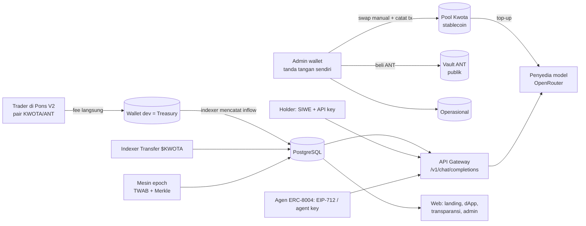

# KWOTA — Rencana Arsitektur (Milestone 1, draft untuk disetujui)

> Status: **Diimplementasikan (milestone 1–6).** Default dari `OPEN_QUESTIONS.md` dipakai untuk semua yang belum dijawab; semuanya bisa diubah lewat parameter admin.
> Pertanyaan terbuka ada di [`OPEN_QUESTIONS.md`](./OPEN_QUESTIONS.md).

---

## 1. Gambaran besar



Prinsip utama:

1. **Server tidak pernah memegang kunci treasury/admin.** Semua aksi on-chain (swap, beli ANT, posting root) ditandatangani dari wallet admin di browser; server hanya *memverifikasi dan mencatat* tx hash.
2. **Satu sumber kebenaran saldo kwota = ledger append-only** (tiap perubahan saldo = satu baris, tidak pernah di-update/delete).
3. **Semua angka uang dalam integer.** 1 kwota = 1 USD = `1_000_000` µkwota (micro). Saldo token on-chain disimpan sebagai `numeric(78,0)`. Tidak ada float di jalur uang.
4. **Semua alamat & parameter di config/DB**, tidak hardcode (kecuali default di `.env.example`).
5. **Invariant solvabilitas:** total kwota beredar (belum terpakai) ≤ saldo stablecoin Pool + kredit di penyedia. Rasio ini tampil di halaman transparansi.

---

## 2. Struktur monorepo

```
kwota/
├─ apps/
│  ├─ web/                 Next.js (App Router) + TS + Tailwind + wagmi/viem
│  │   ├─ (marketing)/     landing
│  │   ├─ app/             dApp: saldo, kwota, API key, agen, playground
│  │   ├─ transparency/    halaman publik
│  │   └─ admin/           dashboard admin (SIWE + allowlist)
│  └─ api/                 Node + TS (Fastify)
│      ├─ src/gateway/     /v1/* kompatibel OpenAI, metering, rate limit
│      ├─ src/auth/        SIWE, sesi, API key, EIP-712 agen
│      ├─ src/indexer/     Transfer $KWOTA, inflow treasury, verifikasi swap
│      ├─ src/epoch/       mesin kwota (TWAB, alokasi, Merkle)
│      ├─ src/agents/      adapter registry ERC-8004, alokasi, batas harian
│      ├─ src/ledger/      satu-satunya modul yang boleh menulis ledger
│      ├─ src/providers/   interface ModelProvider + OpenRouterProvider
│      └─ src/admin/       parameter, blacklist, pencatatan swap
├─ packages/
│  ├─ core/                logika murni (TWAB, split fee, pricing, Merkle leaf) — 100% unit-testable, dipakai api & web
│  ├─ db/                  skema Drizzle + migrasi
│  ├─ config/              loader + validasi env (zod), alamat per chain
│  └─ contracts/           Foundry — kosong di MVP; fase 2: MerkleDistributor / token kwota
├─ docs/
└─ .env.example
```

Proses runtime (satu codebase `apps/api`, beberapa entrypoint):

| Proses | Tugas |
|---|---|
| `api` | HTTP: gateway `/v1/*`, REST untuk dApp/admin/transparansi |
| `indexer` | polling `eth_getLogs` per N detik, simpan Transfer & inflow, handle reorg |
| `worker` | job terjadwal (BullMQ di Redis): tutup epoch, hitung kwota, publikasi Merkle, reset harian, rekonsiliasi |

### Pilihan stack & alasan

| Komponen | Pilihan | Alasan |
|---|---|---|
| Monorepo | pnpm workspaces + Turborepo | sesuai brief; cache build |
| Web | Next.js 15 + Tailwind + wagmi v2 + viem | sesuai brief; chain custom mudah didefinisikan di viem |
| API | **Fastify** | cepat, dukungan streaming SSE bagus (penting untuk proxy `stream: true`), schema validation bawaan |
| ORM | **Drizzle** (bukan Prisma) | SQL eksplisit, migrasi SQL murni, `bigint`/`numeric` lebih natural, mudah membuat trigger "append-only" & query agregasi TWAB. Prisma juga bisa; ini preferensi, bukan keharusan. |
| DB | PostgreSQL 16 | |
| Cache / rate limit / nonce / antrian | Redis + BullMQ | |
| Validasi | zod (dibagi web ↔ api) | |
| Auth wallet | SIWE (EIP-4361) via `viem/siwe`, verifikasi ERC-1271/6492 | holder bisa memakai smart account (ERC-4337) |
| Merkle | `@openzeppelin/merkle-tree` (StandardMerkleTree) | leaf langsung kompatibel dengan kontrak `MerkleProof` OZ di fase 2 |
| Test | Vitest (TS), Foundry (kontrak fase 2) | |
| Lokal | `docker compose` untuk Postgres + Redis | |

---

## 3. Modul inti

### 3.A Pembukuan fee & pool

**Indexer treasury (= wallet dev)**
- Fee trading Pons masuk **langsung ke wallet dev**; wallet ini diperlakukan sebagai treasury (`TREASURY_ADDRESS` = alamat wallet dev, di config).
- Memantau event `Transfer(from, to=TREASURY)` pada daftar token yang dilacak (config: `TRACKED_FEE_TOKENS`, mis. ANT, $KWOTA, WETH, USDG) serta ETH native (tidak menghasilkan log → dideteksi via API Blockscout untuk tx/internal tx ke alamat tersebut). Daftar token cukup diubah di config, tanpa ubah kode.
- Karena wallet dev bisa juga menerima transfer yang bukan fee (mis. setoran pribadi), setiap inflow punya klasifikasi `fee | non_fee`. Default `fee`; admin bisa menandai `non_fee` dari dashboard (tercatat di audit log dan tetap tampil di halaman transparansi, sehingga publik tahu alasannya).
- Wallet dev dimasukkan ke `excluded_addresses` (tidak ikut perhitungan kwota).
- Setiap inflow → baris `treasury_inflows`, lalu otomatis dipecah ke 3 *bucket* (`fee_allocations`) sesuai `fee_split` versi saat itu. Pecahan ini **pembukuan**, bukan transfer otomatis.

**Swap manual (MVP)**
1. Admin melakukan swap/transfer dari wallet-nya sendiri (mis. ANT → USDG untuk Pool, atau kirim ANT ke Vault).
2. Admin menempelkan tx hash di dashboard + memilih bucket.
3. Server mengambil receipt, mendekode log Transfer, memastikan `from`/`to` adalah alamat yang terdaftar (treasury/pool/vault/ops), lalu menyimpan `swaps` dengan `verified=true`. Tx yang tidak cocok ditolak.
4. Harga USD **tidak** diambil dari oracle: nilai yang dihitung sebagai anggaran pool = **jumlah stablecoin yang benar-benar diterima** (realized). Nilai USD inflow lain hanya estimasi informatif.

**Top-up penyedia** — Stablecoin Pool harus berpindah ke kredit OpenRouter (kemungkinan lewat bridge/chain lain, karena penyedia tidak menerima pembayaran di Robinhood Chain). Dicatat di `provider_topups` (tx hash/bukti, jumlah) supaya rantai "fee → pool → kredit penyedia → pemakaian" dapat diaudit penuh.

### 3.B Mesin kwota holder

**Data:** semua `Transfer` $KWOTA diindeks sejak blok deploy → tabel `token_transfers` → saldo per alamat dapat direkonstruksi pada titik waktu mana pun.

**TWAB eksak (bukan sampling):** untuk epoch `[S, E)`:

```
TWAB_i = (1 / (E − S)) · Σ_k  balance_i(segmen k) · durasi(segmen k)
```
Segmen dibentuk oleh setiap Transfer yang menyentuh alamat `i` selama epoch (pakai `block.timestamp`). Ini persis rumus brief "saldo × durasi hold / total": beli 1 menit sebelum epoch tutup ≈ hampir nol porsi, jadi tidak bisa di-*game* dengan beli-sesaat.

**Kelayakan:**
- alamat tidak ada di `excluded_addresses` (LP pair, treasury, vault, ops, kontrak Pons/router, `0x0`, `0x…dEaD`, blacklist manual);
- `TWAB_i ≥ MIN_HOLDING` (usulan; alternatif lihat pertanyaan terbuka).

**Alokasi:**
```
budget_e   = anggaran epoch (µkwota) — lihat pertanyaan Q-E3
share_i    = TWAB_i / Σ TWAB_eligible
kwota_i    = floor(budget_e · TWAB_i / Σ TWAB)      (aritmetika bigint)
dust       = budget_e − Σ kwota_i   → dibawa ke epoch berikutnya
```

**Bukti yang dapat diverifikasi:**
- Leaf = `keccak256(keccak256(abi.encode(uint256 epochId, address holder, uint256 twab, uint256 kwotaMicro)))` (format StandardMerkleTree OZ).
- Dipublikasikan per epoch: file snapshot JSON (seluruh daftar + parameter + blok awal/akhir), SHA-256 file tersebut, dan Merkle root. Siapa pun bisa menjalankan ulang skrip `verify-epoch` (open source di repo) dari data on-chain dan mendapatkan root yang sama.
- Opsional: root diposting on-chain (kontrak `EpochRootRegistry` super kecil atau cukup tx calldata dari wallet admin) — lihat Q-E5.

**Siklus epoch (worker):** `open → closing (tunggu konfirmasi blok) → computed → published`. Kredit ke ledger (`epoch_credit`) hanya terjadi pada status `published`. Perhitungan **deterministik & idempoten** (menjalankan ulang epoch yang sama menghasilkan root identik).

**Desain siap fase 2 (kwota on-chain):** leaf sudah memuat `kwotaMicro`, sehingga kontrak `MerkleDistributor` dapat me-*mint* token kwota saat klaim. Ledger punya jenis entri `onchain_claim` (memindahkan saldo off-chain → on-chain) dan `onchain_deposit` (burn token → saldo gateway), jadi model akun tidak perlu diubah.

### 3.C API gateway

- Endpoint: `GET /v1/models`, `POST /v1/chat/completions` (termasuk `stream: true`). Format request/response mengikuti OpenAI, jadi SDK OpenAI cukup ganti `baseURL` + key.
- **Lapisan provider:**
  ```ts
  interface ModelProvider {
    id: string;
    listModels(): Promise<ProviderModel[]>;
    chat(req, signal): Promise<ChatResult>;           // non-stream
    chatStream(req, signal): AsyncIterable<Chunk>;    // stream, harus mengembalikan usage final
  }
  ```
  Implementasi pertama: `OpenRouterProvider`. Daftar model yang *diizinkan* & harga kwota disimpan di tabel `models` (allowlist), bukan diteruskan mentah dari penyedia.
- **Metering (reserve → settle):**
  1. Auth → tentukan akun kwota (holder atau agen).
  2. Hitung *biaya maksimum*: `est_input_tokens × in_price + max_tokens × out_price` (max_tokens dibatasi `MAX_OUTPUT_TOKENS` & `MAX_COST_PER_REQUEST`).
  3. **Reserve** sejumlah itu secara atomik (transaksi DB + `SELECT … FOR UPDATE` pada akun). Untuk agen, cek juga sisa batas harian.
  4. Teruskan ke provider.
  5. **Settle** dengan token aktual dari `usage` penyedia: `cost = ceil(in_tok × in_price + out_tok × out_price)` (harga = harga penyedia × (1 + markup_bps), µkwota per token). Lepas sisa reservasi.
  6. Jika provider gagal → reservasi dilepas penuh; jika stream terputus di tengah → tagih token yang sudah terkirim (usage dari provider, fallback hitung lokal dengan tokenizer).
- **Auth holder:** SIWE → sesi (cookie httpOnly). Holder membuat API key `kw_live_<prefix>_<secret>`; DB menyimpan `prefix` + `sha256(secret)` (key tampil sekali). Bisa dicabut, ada `last_used_at`.
- **Rate limit:** Redis sliding window per key dan per wallet (RPM + token/menit), plus batas biaya per request. Semua request tercatat di `usage_requests`.
- Kunci penyedia hanya di env server (`OPENROUTER_API_KEY`), tidak pernah di repo/klien.

### 3.D Lapisan agen (tidak mengubah alur holder)

- **Adapter registry ERC-8004:**
  ```ts
  interface AgentRegistryAdapter {
    resolve(agentId: bigint): Promise<{ owner: Address; agentWallet?: Address; uri?: string }>;
  }
  ```
  Default membaca kontrak Identity Registry ERC-8004 (ERC-721: `ownerOf`, `tokenURI`; wallet agen dari metadata on-chain/registration file). Alamat & ABI registry di config, sehingga bisa diarahkan ke registry Agent Mint Anda atau registry lain.
- **Akun agen** = sub-akun ledger (`kwota_accounts.type='agent'`) milik holder. Alokasi = 2 entri ledger (`allocation_out` di akun holder, `allocation_in` di akun agen) dalam satu transaksi.
- **Syarat registrasi:** wallet yang login (SIWE) harus = `ownerOf(agentId)` saat registrasi; dicek ulang berkala. Jika NFT agen berpindah pemilik → agen otomatis dibekukan, sisa alokasi hanya bisa ditarik oleh pengalokasi awal.
- **Batas harian:** `daily_limit_micro` per agen, dihitung per hari UTC (atau rolling 24 jam — Q-A3); dicek saat *reserve*.
- **Auth agen** (dua opsi, keduanya didukung):
  1. **EIP-712 per request** — header `X-Kwota-Agent`, `X-Kwota-Nonce`, `X-Kwota-Expiry`, `X-Kwota-Signature`. Typed data:
     ```
     KwotaRequest(uint256 agentId, bytes32 bodyHash, uint256 nonce, uint64 expiry)
     domain: { name: "KWOTA Gateway", version: "1", chainId, verifyingContract: <registry> }
     ```
     Server: cek `expiry` (maks. 5 menit ke depan), `SET NX` nonce di Redis dengan TTL sampai expiry (anti-replay), `bodyHash == keccak256(rawBody)`, signer == wallet agen (mendukung ERC-1271 untuk smart account).
  2. **Agent API key** — sama seperti key holder, tapi terikat ke `agent_id` dan hanya bisa memotong akun agen tersebut.
- **Tombol stop:** `status='stopped'` → semua key agen langsung ditolak (cek di Redis + DB), reservasi berjalan diselesaikan, holder bisa `reclaim` sisa saldo agen ke akun holder.

### 3.E Frontend

- **Landing:** narasi, alur fee → pool → kwota → AI (animasi meteran), fitur agen, tokenomics (split dari config), CA (dari config, tombol salin), tautan Pons/DexScreener/X, disclaimer non-afiliasi di footer.
- **dApp:** connect wallet (chain Robinhood testnet/mainnet didefinisikan di viem), saldo $KWOTA (on-chain), estimasi kwota epoch berjalan (TWAB sementara × anggaran proyeksi), saldo & riwayat ledger, kelola API key, halaman agen, playground chat (streaming, memotong kwota nyata).
- **Transparansi (publik, tanpa login):** total fee masuk per token, pembagian per bucket, isi Pool (on-chain + kredit penyedia), saldo Vault ANT (dibaca langsung on-chain di browser via viem), riwayat swap (tautan Blockscout), kwota terdistribusi per epoch + Merkle root + unduh snapshot, daftar model & harga, rasio solvabilitas, rumus kwota.
- **Admin:** SIWE + allowlist `ADMIN_ADDRESSES`. Perubahan parameter wajib disertai **tanda tangan EIP-712 dari wallet admin** (disimpan di audit log) — server tidak bisa mengubah parameter sendiri.
- **Desain:** tema "meteran/gauge kuota" — angka monospace besar, progress bar, palet netral + satu warna aksen (mis. hijau-lime atau amber). Tanpa motif otak/neuron. Tanpa nama/logo Anthropic, Claude, Robinhood.

---

## 4. Skema database (draft)

Konvensi: `*_micro` = `bigint` µkwota; `*_raw` = `numeric(78,0)` jumlah token dalam unit terkecil; alamat disimpan lowercase `char(42)`; semua tabel punya `created_at timestamptz`.

### Konfigurasi & audit
| Tabel | Kolom penting | Catatan |
|---|---|---|
| `params` | `key` PK, `value jsonb`, `version int`, `updated_by`, `updated_at` | `fee_split`, `min_holding_raw`, `epoch_seconds`, `epoch_budget_policy`, `max_cost_per_request_micro`, dst. |
| `param_versions` | `id`, `key`, `version`, `value jsonb`, `signature`, `signer`, `effective_from` | riwayat; epoch menyimpan versi param yang dipakai |
| `excluded_addresses` | `address` PK, `reason enum(lp,treasury,vault,ops,protocol,burn,blacklist)`, `active`, `note`, `added_by` | |
| `audit_log` | `id`, `actor`, `action`, `target_type`, `target_id`, `before jsonb`, `after jsonb`, `signature`, `ip`, `created_at` | append-only |

### Indexer
| Tabel | Kolom penting | Catatan |
|---|---|---|
| `indexer_cursors` | `name` PK, `chain_id`, `last_block`, `last_block_hash` | deteksi reorg |
| `token_transfers` | `chain_id, tx_hash, log_index` (unik), `block_number`, `block_hash`, `block_time`, `token`, `from`, `to`, `amount_raw` | semua Transfer $KWOTA (+ token fee yang dilacak) |
| `holder_balances` | `address` PK, `balance_raw`, `last_block` | cache saldo terkini, bisa dibangun ulang dari transfers |
| `treasury_inflows` | `id`, `transfer_id` FK / `native_tx`, `token`, `amount_raw`, `usd_estimate_micro` (nullable), `block_time`, `classification enum(fee,non_fee)`, `classified_by`, `classification_note` | treasury = wallet dev |
| `fee_allocations` | `id`, `inflow_id`, `bucket enum(pool,vault,ops)`, `amount_raw`, `split_version` | pembukuan |
| `swaps` | `id`, `bucket`, `tx_hash`, `from_token`, `from_amount_raw`, `to_token`, `to_amount_raw`, `to_address`, `recorded_by`, `verified`, `verified_at`, `note` | diverifikasi dari receipt |
| `provider_topups` | `id`, `provider`, `amount_micro`, `proof_ref` (tx hash/invoice id), `recorded_by` | |

### Epoch
| Tabel | Kolom penting | Catatan |
|---|---|---|
| `epochs` | `id` PK (serial), `start_time`, `end_time`, `start_block`, `end_block`, `status enum(open,closing,computed,published)`, `budget_micro`, `dust_in_micro`, `dust_out_micro`, `total_twab`, `eligible_count`, `merkle_root`, `snapshot_uri`, `snapshot_sha256`, `param_versions jsonb`, `onchain_tx` (opsional) | |
| `epoch_allocations` | `(epoch_id, address)` PK, `twab_raw`, `share_ppm`, `kwota_micro`, `leaf` | proof dihitung on-demand dari tree |

### Pengguna, kunci, ledger
| Tabel | Kolom penting | Catatan |
|---|---|---|
| `users` | `id`, `address` unik | dibuat saat SIWE pertama atau saat dapat alokasi epoch |
| `kwota_accounts` | `id`, `user_id`, `type enum(holder,agent)`, `agent_id` (nullable, unik), `balance_micro`, `reserved_micro`, `version` | cache saldo; CHECK `balance_micro ≥ reserved_micro ≥ 0` |
| `ledger_entries` | `id`, `account_id`, `delta_micro` (±), `kind enum(epoch_credit, usage_debit, allocation_out, allocation_in, reclaim_out, reclaim_in, admin_adjust, expiry, onchain_claim, onchain_deposit)` — reservasi tidak menulis ledger (dicatat di `kwota_accounts.reserved_micro` + `usage_requests`), hanya debit final yang masuk ledger, `ref_type`, `ref_id`, `balance_after_micro`, `actor`, `created_at` | **append-only** (trigger menolak UPDATE/DELETE); Σ delta = balance |
| `api_keys` | `id`, `user_id`, `agent_id` (nullable), `name`, `prefix` unik, `secret_hash`, `rpm_limit`, `max_cost_per_request_micro`, `last_used_at`, `revoked_at` | |

### Gateway & model
| Tabel | Kolom penting | Catatan |
|---|---|---|
| `models` | `id` (slug publik), `provider`, `provider_model_id`, `display_name`, `context_length`, `input_price_micro_per_mtok`, `output_price_micro_per_mtok`, `markup_bps`, `enabled` | tampil di `/v1/models` & transparansi |
| `usage_requests` | `id`, `account_id`, `api_key_id`, `agent_id`, `model_id`, `status enum(reserved,settled,failed,released)`, `stream`, `input_tokens`, `output_tokens`, `reserved_micro`, `cost_micro`, `provider_request_id`, `latency_ms`, `error_code`, `auth_method enum(api_key,eip712)`, `nonce` | |

### Agen
| Tabel | Kolom penting | Catatan |
|---|---|---|
| `agent_registries` | `id`, `chain_id`, `address`, `adapter enum(erc8004_v1, custom)`, `name`, `enabled` | |
| `agents` | `id`, `registry_id`, `agent_token_id numeric`, `owner_address` (cache), `agent_wallet`, `allocator_user_id`, `status enum(active,stopped,frozen)`, `daily_limit_micro`, `last_verified_at` | unik `(registry_id, agent_token_id)` |
| `agent_daily_usage` | `(agent_id, day)` PK, `spent_micro` | pengganti/backup counter Redis |

Nonce EIP-712 & sesi SIWE disimpan di Redis (TTL); nonce juga tercatat di `usage_requests` untuk audit.

---

## 5. Keamanan (ringkas)

- Tidak ada private key di server; `.env` hanya berisi RPC URL, DB URL, Redis URL, `OPENROUTER_API_KEY`, `SESSION_SECRET`, alamat publik.
- Aksi admin: SIWE + allowlist + tanda tangan EIP-712 per perubahan; disarankan wallet admin = Safe multisig.
- Ledger append-only + rekonsiliasi harian (Σ ledger = cache saldo; Σ kwota beredar ≤ dana pool) → alarm bila selisih.
- Anti-replay agen: nonce + expiry + body hash; batas expiry maksimal.
- Validasi input zod di semua endpoint; batas ukuran body; CORS ketat untuk endpoint sesi; gateway `/v1` memakai bearer key (tanpa cookie).
- Indexer menunggu `CONFIRMATIONS` blok sebelum data dipakai untuk epoch; reorg → rollback ke blok aman.
- `gitleaks` di pre-commit/CI.

## 6. Strategi test

- `packages/core` (murni): TWAB (transfer di tengah epoch, saldo 0 → beli → jual, banyak transfer per blok, transfer antar alamat yang dikecualikan), minimum holding, pengecualian alamat, pembulatan & dust, split fee, kalkulasi biaya metering, leaf/root Merkle (dibandingkan dengan vektor dari OZ).
- `apps/api`: test integrasi dengan Postgres+Redis di docker (reserve/settle konkuren, batas harian agen, replay nonce ditolak, key dicabut, stream terputus), provider di-mock.
- Fixture "epoch emas": dataset transfer sintetis + root yang diharapkan, agar perubahan kode yang mengubah hasil langsung ketahuan.

## 7. Milestone (sesuai brief)

1. ✅ Rencana arsitektur + skema + pertanyaan terbuka.
2. ✅ Scaffold monorepo + landing page + halaman transparansi (data dummy dari API mock).
3. ✅ Indexer $KWOTA & treasury (testnet 46630) + mesin kwota + test + skrip `verify-epoch`.
4. ✅ Gateway + SIWE + API key + metering + playground.
5. ✅ Lapisan agen (adapter ERC-8004, alokasi, batas harian, EIP-712).
6. ✅ Dashboard admin + penyempurnaan + checklist pre-mainnet.

Catatan: karena $KWOTA belum diluncurkan, untuk milestone 3 saya akan men-deploy **token ERC-20 tiruan di testnet** (via Foundry, hanya untuk pengujian) agar indexer & mesin kwota bisa diuji end-to-end.
